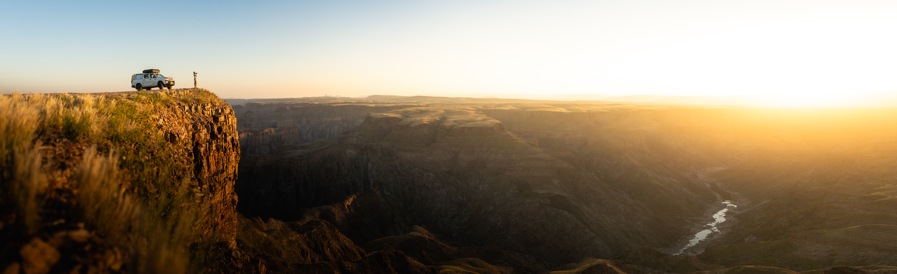
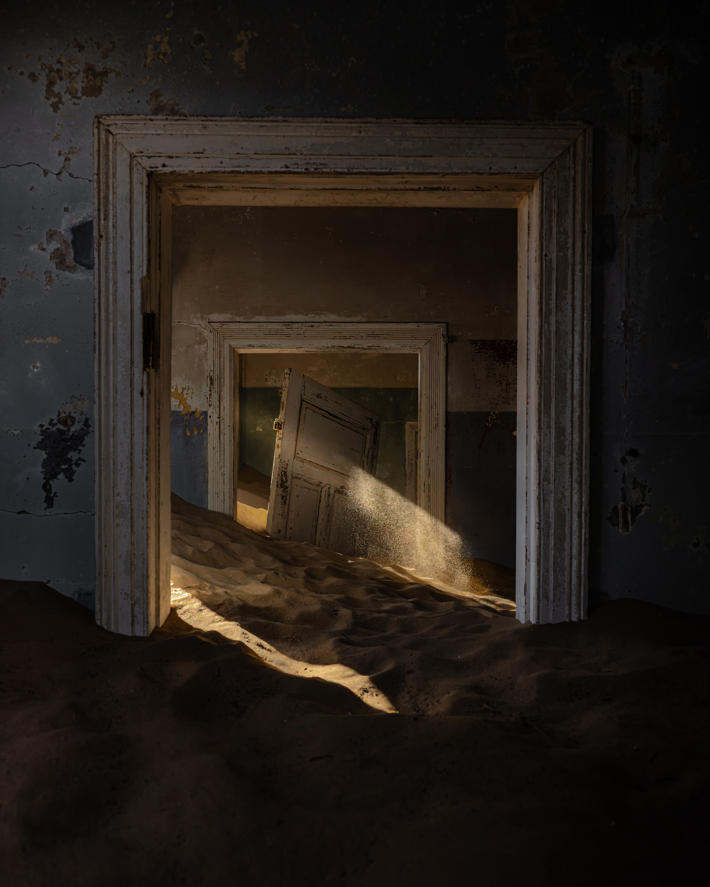
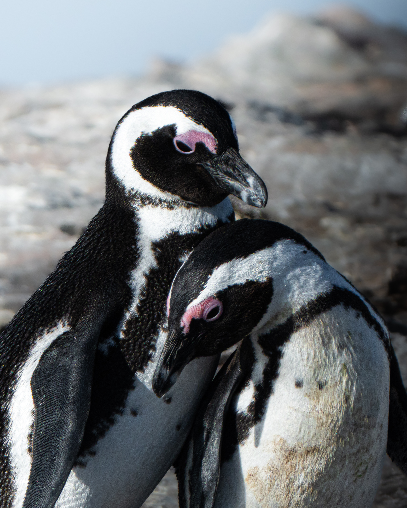

La Namibia è già un posto ai margini degli itinerari africani mainstream, potreste pensare che sia già mainstream perché guardate troppo Instagram, ma nella realtà dei fatti, quando sei li tu rendi conto che di turisti non ce ne sono poi così tanti. Vuoi perché gli spazzi sono così grandi da non sentire la pressione di altre persone vicine, o perché è un luogo visitabile tutto l'anno, ma non si avverte quasi mai la pressione turistica. Il suo sud lo è ancora di più, una regione che la maggior parte dei viaggiatori non affronta, perché è lontana e forse perché non si Sto arrivando! bene cosa ci sia realmente. 

Beh privarsene potrebbe essere un errore. Qui ti posso dare dei validi motivi per cui il sud della Namibia potrebbe essere un viaggio assestante!

## Fish River Canyon

Lungo 160 chilometri, profondo fino a 550 metri. Lo si guarda dall'alto dal belvedere principale e non si riesce a misurarne le dimensioni che, lo rendono il secondo Canyon piu grande al mondo dopo il gran Canyon, ma paragonandolo con quest'ultimo, dobbiamo affrontare una differenza enorme.

Siamo stati proprio un anno fa la Grand Canyon, e si, è un bel luogo, ma prima del canyon quello che ti colpisce è il turismo, strade asfaltate, pulmini che si muovono come in una grande città. Beh il Fish River è totalmente l'opposto, apparte il main View Point, dove si possono trovare un po di persone a goder del panorama dalla piattaforma, spostandosi di qualche centinaio di metri arrivando a tanti altri View Point presenti, ci si puo trovare completamente soli ad ammirare uno dei panorami piu belli del mondo. 

Se poi si ha il tempo e si è abbastanza esploratori, oltre a guardarlo dall'alto ci si puo entrare.

Il trekking di cinque giorni sul fondo è uno dei percorsi più duri dell'Africa australe. Senza ombra, senza acqua corrente garantita, temperature sopra i 40 gradi in certi periodi. Lo si fa in piccoli gruppi, con un permesso, in stagione secca, ma in questo modo si puo anche   capire davvero l'incredibile dimensione di questo luogo.

## Lüderitz

Una città coloniale tedesca nel mezzo del Nulla, affacciata sull'Atlantico. Architettura Art Nouveau, strade ventose, aragoste estremamente economiche, case arroccate sugli scogli e vista della baia. é un luogo estremamente isolato e particolare, in cui però si respira un'atmosfera davvero suggestiva.

## Kolmanskop

Un luogo surreale, antica cittadina mineraria, a pochi chilometri da Luderitz, una volta popolata da centinaia di minatori con le rispettive famiglie, alla ricerca di diamanti. La cittadina era completa, con tutti i confort, scuola, centro medico, alloggi, tutto funzionava, fino quando i diamanti finirono, a quel punto Kolamanskop venne abbandonata, da li a pochi anni, il deserto la fece sua, la sabbia fine unita al vento costiero si insinuò nelle case, riempiendole di dune, creando così delle scene UNICHE.

Questo è un luogo speciale per la fotografia, si possono catturare immagini suggestive e mai uguali, perche giorno dopo giorno sabbia e vento modificano ogni vista, rendendo il paese in continua evoluzione.

## I pinguini

Cosa che nessuno Sa, in Namibia esistono i pinguini, proprio così i PINGUINI.

Non troppo distante da Luderitz, circa un ora di catamarano, su un isola in mezzo all'Atlantico vive una colonia con centinaia di pinguini africani. Si muovono tra scogli onde e le poche strutture umane ormai abbandonate. 

Incredibile pensarli così vicini al deserto, questa esperienza da sola vale l'intero viaggio!

